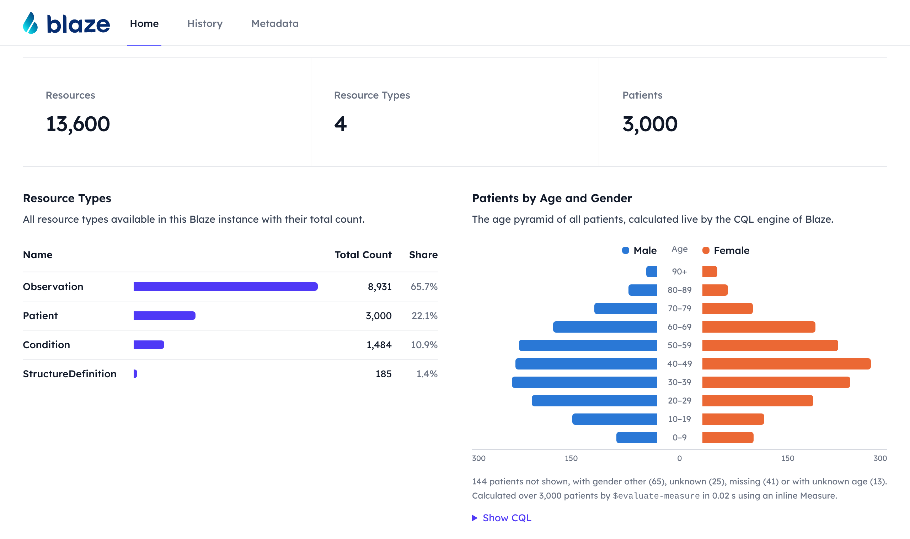
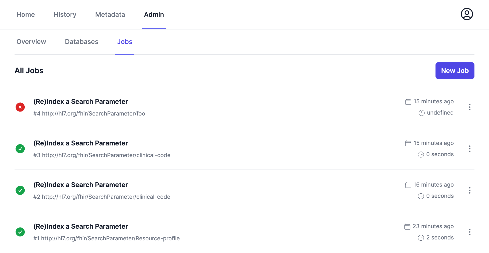
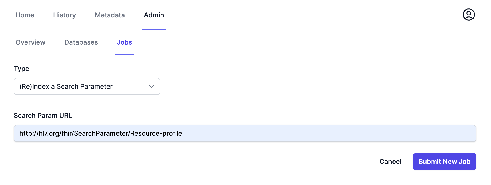
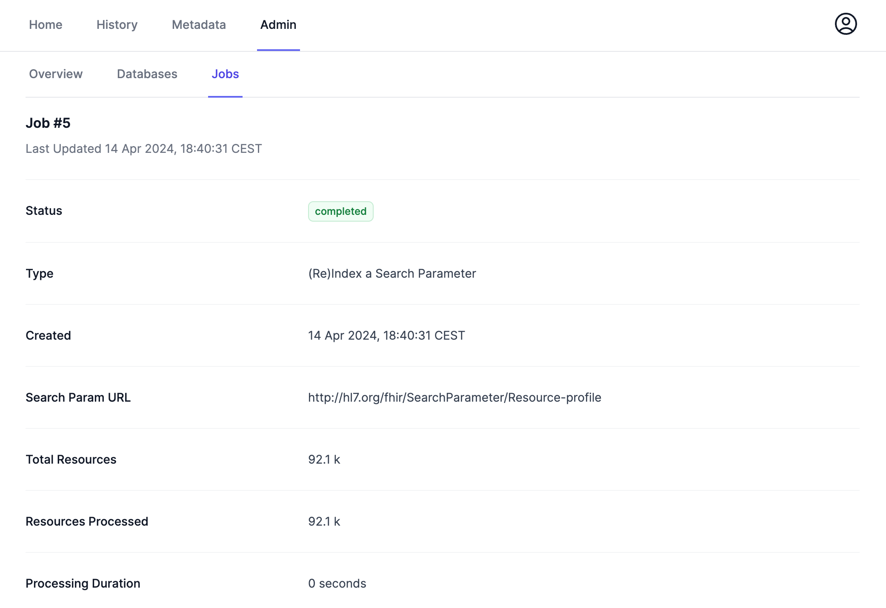

# Web Frontend

Blaze comes with a Web UI that provides a user friendly view on the FHIR data and and administrative UI.

## FHIR View

### Home <Badge type="warning" text="Since 1.14.0"/>

The home page shows the total number of resources, resource types and patients, followed by all resource types ranked by their total count. If patients are available, an age pyramid of all patients by gender is shown next to it. It's calculated live by the CQL engine of Blaze, evaluating an [inline Measure](api/operation/measure-evaluate-measure.md#inline-measure) with `$evaluate-measure`. The CQL used can be shown below the pyramid.

## Admin UI

**TODO**

### Databases

The state of the RocksDB databases of Blaze can be inspected in the Databases section of the Admin UI, described on a [separate page](frontend/databases.md).

### Job System

The next part of the Admin UI is a job system where background jobs of Blaze can be managed. Currently, the only available job type is **(Re)Index a Search Parameter**.  

A new job can be created by clicking on the **New Job** button on the Jobs page in the Admin UI.

After that a page with a job form opens. For the **(Re)Index a Search Parameter** job, the URL of the search parameter has to be specified.

After submitting the job, the job detail page will open.

